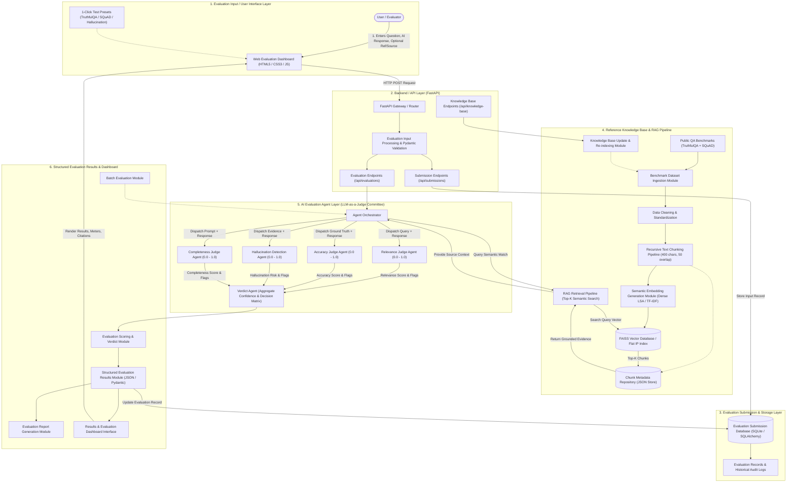

# AI Response Validation System with Hallucination Detection Assistance

[](https://springboard.infosys.com/)
[](https://www.python.org/)
[](https://fastapi.tiangolo.com/)
[](https://github.com/facebookresearch/faiss)
[-success.svg)](./scripts/run_tests.py)

An automated AI Response Validation and Hallucination Detection framework built for **Infosys Springboard**. The system evaluates AI-generated responses using a multi-agent **LLM-as-a-Judge** architecture grounded in a **Reference Knowledge Base** seeded with public QA benchmarks (**TruthfulQA** and **SQuAD** from Hugging Face).

---

## 📋 Milestone 1 Completion Overview

This repository fulfills all requirements for **Milestone 1: Foundation & Evaluation Understanding**:

- **M1.1 — Research & Technical Understanding:**
  - In-depth study of LLM evaluation techniques, hallucination detection taxonomies, RAG architecture, semantic vector search, and existing frameworks (RAGAS and TruLens).
  - Documented findings, scoring methodologies, and technology selections in [`docs/M1_RESEARCH_AND_TECHNICAL_UNDERSTANDING.md`](./docs/M1_RESEARCH_AND_TECHNICAL_UNDERSTANDING.md).
- **M1.2 — System Architecture:**
  - Designed system architecture covering all mentor-specified modules.
  - Defined multi-agent responsibilities (*Orchestrator, Relevance Judge, Accuracy Judge, Hallucination Detection Agent, Completeness Judge, and Verdict Agent*).
  - Defined scoring dimensions (`0.0` - `1.0`), weights, mathematical aggregation, and decision matrix in [`docs/M1_SYSTEM_ARCHITECTURE.md`](./docs/M1_SYSTEM_ARCHITECTURE.md).
  - Visualized architecture in [`docs/diagrams/architecture_diagram.mermaid`](./docs/diagrams/architecture_diagram.mermaid).
- **M1.3 — Evaluation Input Module:**
  - Built single submission interface accepting:
    - `question` (required prompt)
    - `ai_response` (required AI response to validate)
    - `reference_answer` (optional ground truth)
    - `source_document` (optional reference context)
  - Implemented rigorous Pydantic v2 input validation, sanitization, and error handling.
  - Built REST API layer and SQLite/SQLAlchemy persistence.
  - Created interactive web interface with 1-click test presets in [`app/static/`](./app/static/).
- **M1.4 — Reference Knowledge Base:**
  - Seeded and standardized public QA benchmark datasets from Hugging Face (**TruthfulQA** for misconceptions and **SQuAD** for reading comprehension extraction).
  - Implemented recursive sliding-window text chunker (400 chars, 50 overlap) preserving sentence boundaries.
  - Built semantic dense embedding generator and FAISS vector index with metadata storage.
  - Built RAG semantic retrieval pipeline and validated retrieval quality with 100% accuracy via [`scripts/validate_retrieval.py`](./scripts/validate_retrieval.py).

---

## 🏛️ System Architecture



---

## 🛠️ Technology Stack

| Layer | Technologies Used |
| :--- | :--- |
| **Backend & Web Framework** | **FastAPI**, **Uvicorn**, **Pydantic v2** |
| **Database & ORM** | **SQLAlchemy**, **SQLite** |
| **Vector Store & Indexing** | **FAISS (IndexFlatIP)** with seamless **NumPy** fallback |
| **Semantic Embeddings** | **Scikit-Learn (TF-IDF + TruncatedSVD / LSA)** dense vector space (100% offline & reproducible) |
| **Reference Benchmarks** | **TruthfulQA** (misconceptions) & **SQuAD** (factual reading comprehension) from Hugging Face |
| **Frontend UI** | **HTML5**, **CSS3**, **Vanilla JavaScript** (Responsive Dashboard with glassmorphism styling) |
| **Testing & Quality** | **Pytest** and automated regression test runner |

---

## 📊 Evaluation Scoring Dimensions

Our multi-agent committee evaluates responses across 4 core dimensions normalized to `[0.0, 1.0]`:

| Dimension | Weight | Description | Threshold / Target |
| :--- | :---: | :--- | :--- |
| **Relevance** | `0.25` | Does response directly address the question intent? | $\ge 0.50$ (Relevance) |
| **Accuracy** | `0.35` | Factual correctness against reference / knowledge base. | $\ge 0.65$ (Factual Match) |
| **Hallucination Risk** | `0.25` | Extent of fabricated or ungrounded claims. | $\le 0.25$ (Grounded) |
| **Completeness** | `0.15` | Coverage of essential entities and question facets. | $\ge 0.50$ (Complete) |

$$\text{Overall Confidence Score} = 0.25 \times \text{Relevance} + 0.35 \times \text{Accuracy} + 0.25 \times (1.0 - \text{Hallucination}) + 0.15 \times \text{Completeness}$$

### Final Verdict Classification:
- **`PASSED`**: Response is accurate, relevant, complete, and grounded in evidence.
- **`SUSPECTED_HALLUCINATION`**: High risk ($\ge 0.50$) of ungrounded or contradictory assertions.
- **`FACTUALLY_INCORRECT`**: Response contradicts reference answer or benchmark knowledge.
- **`OFF_TOPIC`**: Response does not address prompt's question.
- **`INCOMPLETE`**: Response fails to provide sufficient explanation.

---

## 🚀 Quick Start Guide

### 1. Clone & Set Up Environment
```bash
# Clone the repository
git clone https://github.com/gowthamsai1509/Development-of-AI-Response-Validation-System-with-Hallucination-Detection-Assistance.git
cd Development-of-AI-Response-Validation-System-with-Hallucination-Detection-Assistance


# Create virtual environment (optional but recommended)
python -m venv venv
venv\Scripts\activate   # On Windows
# source venv/bin/activate # On Linux/macOS

# Install dependencies
pip install -r requirements.txt
```

### 2. Seed the Reference Knowledge Base
Ingests TruthfulQA and SQuAD benchmark datasets, applies sliding window chunking, generates embeddings, and creates the FAISS vector index:
```bash
python scripts/seed_knowledge_base.py
```

### 3. Validate Semantic Retrieval Quality
Runs benchmark queries to verify top-$K$ semantic retrieval accuracy:
```bash
python scripts/validate_retrieval.py
```

### 4. Run the Automated Test Suite
Executes the comprehensive 16-point automated test suite:
```bash
python scripts/run_tests.py
```

### 5. Launch the Web Application
```bash
python -m uvicorn app.main:app --host 127.0.0.1 --port 8000 --reload
```
- **Web UI:** Open [http://127.0.0.1:8000](http://127.0.0.1:8000) in your browser.
- **Interactive Swagger API Docs:** Open [http://127.0.0.1:8000/docs](http://127.0.0.1:8000/docs).

---

## 📂 Project Repository Structure

```
Development-of-AI-Response-Validation-System-with-Hallucination-Detection-Assistance/
├── README.md                                # Project overview, setup, and submission report
├── requirements.txt                         # Python dependencies
├── .gitignore                               # Git ignore configuration
│
├── docs/                                    # Detailed project documentation
│   ├── M1_RESEARCH_AND_TECHNICAL_UNDERSTANDING.md # Milestone 1.1 Research Report
│   ├── M1_SYSTEM_ARCHITECTURE.md            # Milestone 1.2 System Architecture & Flow
│   ├── M1_TECH_STACK_AND_SPECIFICATION.md   # Complete Tech Stack Specifications
│   └── diagrams/
│       └── architecture_diagram.mermaid     # Complete Mermaid architecture source
│
├── data/
│   ├── raw/                                 # Raw public QA benchmark datasets
│   │   ├── truthfulqa_sample.json           # TruthfulQA benchmark subset
│   │   └── squad_sample.json                # SQuAD reading comprehension subset
│   └── processed/
│       └── faiss_index/                     # FAISS vector index & metadata repository
│           ├── faiss.index                  # Binary vector index
│           ├── vectors.npy                  # NumPy vector array backup
│           └── metadata.json                # Chunk metadata and text store
│
├── app/                                     # Core Application Package
│   ├── config.py                            # Central configuration & hyperparameters
│   ├── main.py                              # FastAPI application & route mounting
│   ├── database/                            # SQLite persistence layer
│   │   ├── connection.py                    # SQLAlchemy session & engine
│   │   └── models.py                        # EvaluationRecord ORM model
│   ├── schemas/                             # Pydantic data models & contracts
│   │   ├── submission.py                    # Input validation & submission schemas
│   │   ├── evaluation.py                    # Scores, AgentVerdict, and EvaluationResult
│   │   └── knowledge_base.py                # Chunk and retrieval schemas
│   ├── knowledge_base/                      # RAG Knowledge Base & Indexing
│   │   ├── chunker.py                       # Recursive sliding window text chunker
│   │   ├── embeddings.py                    # Dense semantic vector generator (LSA/TF-IDF)
│   │   ├── vector_store.py                  # FAISS & NumPy dual-backend vector store
│   │   ├── ingestion.py                     # Benchmark dataset ingestion pipeline
│   │   └── retriever.py                     # Top-K semantic retrieval engine
│   ├── agents/                              # Multi-Agent Judge Committee
│   │   ├── base_agent.py                    # Abstract BaseJudgeAgent
│   │   ├── relevance_agent.py               # Relevance Judge Agent
│   │   ├── accuracy_agent.py                # Accuracy Judge Agent
│   │   ├── hallucination_agent.py           # Hallucination Detection Agent
│   │   ├── completeness_agent.py            # Completeness Judge Agent
│   │   ├── verdict_agent.py                 # Verdict Agent & Decision Matrix
│   │   └── orchestrator.py                  # Evaluation Orchestrator
│   ├── api/                                 # REST API Routers
│   │   ├── routes_submission.py             # Single submission endpoints
│   │   ├── routes_evaluation.py             # Multi-agent evaluation endpoints
│   │   └── routes_knowledge_base.py         # Knowledge base & retrieval endpoints
│   └── static/                              # Evaluation Input Module UI
│       ├── index.html                       # Modern evaluation dashboard
│       ├── style.css                        # Glassmorphism styling & status badges
│       └── app.js                           # Frontend API bindings & presets
│
├── scripts/                                 # Executable CLI Scripts
│   ├── seed_knowledge_base.py               # Ingests & indexes benchmark datasets
│   ├── validate_retrieval.py                # Semantic retrieval quality validation
│   └── run_tests.py                         # Automated 16-point test suite
│
└── tests/                                   # Pytest Unit & Integration Tests
    ├── test_input_validation.py             # Input sanitization & edge cases
    ├── test_knowledge_base.py               # Chunking & vector index unit tests
    └── test_evaluation_flow.py              # End-to-end evaluation flow tests
```

---

## 📌 Submission Summary for Milestone 1

- **GitHub Repository Link:** [https://github.com/gowthamsai1509/Development-of-AI-Response-Validation-System-with-Hallucination-Detection-Assistance](https://github.com/gowthamsai1509/Development-of-AI-Response-Validation-System-with-Hallucination-Detection-Assistance)
- **Interactive Web Interface:** [http://127.0.0.1:8000](http://127.0.0.1:8000)
- **Interactive Swagger API Documentation:** [http://127.0.0.1:8000/docs](http://127.0.0.1:8000/docs)
- **ReDoc API Documentation:** [http://127.0.0.1:8000/redoc](http://127.0.0.1:8000/redoc)
- **System Architecture:** Detailed architecture diagram and agent specifications available at [`docs/M1_SYSTEM_ARCHITECTURE.md`](./docs/M1_SYSTEM_ARCHITECTURE.md).
- **Tech Stack:** Comprehensive tech stack breakdown and specification available at [`docs/M1_TECH_STACK_AND_SPECIFICATION.md`](./docs/M1_TECH_STACK_AND_SPECIFICATION.md).
- **Automated Testing & Validation:** 100% test pass rate across all modules verified by [`scripts/run_tests.py`](./scripts/run_tests.py).

