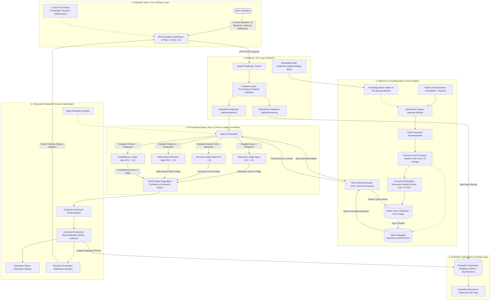
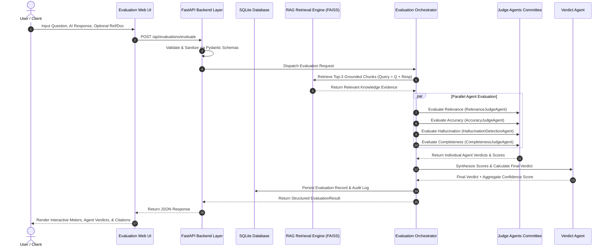

# Milestone 1.2: System Architecture & Agent Specifications

**Project Title:** Development of AI Response Validation System with Hallucination Detection Assistance  
**Program:** Infosys Springboard  
**Date:** November 2026  

---

## 1. System Architecture Diagram

---

## 2. Multi-Agent Responsibilities & Committee Architecture

To eliminate the biases and blind spots of monolithic evaluation prompts, evaluation is decoupled across a committee of specialized judge agents:

| Agent Name | Role & Responsibility | Primary Inputs | Output & Artifacts |
| :--- | :--- | :--- | :--- |
| **Evaluation Orchestrator** | Coordinates the entire evaluation lifecycle. Triggers RAG retrieval, passes contextual evidence to judges, collects agent outputs, and coordinates database persistence. | `SubmissionRequest`, DB Session | Fully hydrated `EvaluationResult` |
| **Relevance Judge Agent** | Assesses whether the AI-generated response directly addresses the prompt's intent and topic. Penalizes evasion or off-topic digression. | `question`, `ai_response` | `relevance_score` $\in [0.0, 1.0]$, reasoning, `POTENTIALLY_OFF_TOPIC` flags |
| **Accuracy Judge Agent** | Cross-checks factual claims against available ground truth (user reference answer, source document, or RAG retrieved context). | `ai_response`, `reference_answer`, `retrieved_context` | `accuracy_score` $\in [0.0, 1.0]$, factual agreement reasoning, `FACTUAL_DIVERGENCE` flags |
| **Hallucination Detection Agent** | Detects intrinsic/extrinsic hallucinations, fabricated entities, unverified absolute claims, and known misconception patterns (from TruthfulQA). | `ai_response`, `retrieved_context`, `question` | `hallucination_score` $\in [0.0, 1.0]$, risk level, anomaly flags (`UNVERIFIED_ABSOLUTE_CLAIM`, `CONTRADICTION`) |
| **Completeness Judge Agent** | Evaluates whether multi-part questions, constraints, or necessary explanatory details were adequately answered. | `question`, `ai_response` | `completeness_score` $\in [0.0, 1.0]$, coverage reasoning, `INCOMPLETE_ANSWER` flags |
| **Verdict Agent** | Synthesizes all agent dimension scores, applies the decision matrix, calculates overall confidence, and assigns the final verdict classification. | All 4 Agent Verdicts | `VerdictType` enum, overall confidence score, synthesized summary |

---

## 3. Scoring Dimensions, Scale, & Decision Matrix

### 3.1 Dimension Definitions
All dimensions are calibrated on a continuous scale of `0.0` to `1.0` (or `0%` to `100%`):

1. **Relevance Score ($S_{rel}$):**
   - $0.80 - 1.00$: Directly and specifically addresses query intent.
   - $0.50 - 0.79$: Partially relevant with minor tangential information.
   - $0.00 - 0.49$: Evasive, completely off-topic, or irrelevant.

2. **Accuracy Score ($S_{acc}$):**
   - $0.80 - 1.00$: Factually substantiated by ground truth and knowledge base.
   - $0.50 - 0.79$: Plausible but contains unverified or partially matched claims.
   - $0.00 - 0.49$: Factually incorrect or contradicts established facts.

3. **Hallucination Risk ($S_{hal}$):**
   - $0.00 - 0.25$: Fully grounded; claims backed by evidence.
   - $0.26 - 0.49$: Moderate risk; minor speculative or ungrounded phrasing.
   - $0.50 - 1.00$: High hallucination probability; contains blatant fabrications or contradictions.

4. **Completeness Score ($S_{com}$):**
   - $0.80 - 1.00$: Comprehensive coverage of all sub-questions and key entities.
   - $0.50 - 0.79$: Satisfactory response but missing minor details or nuance.
   - $0.00 - 0.49$: Terse, truncated, or incomplete answer.

### 3.2 Overall Confidence Score Calculation
The overall confidence score $S_{overall}$ integrates all dimensions with calibrated weights:
$$S_{overall} = w_{rel} \cdot S_{rel} + w_{acc} \cdot S_{acc} + w_{hal} \cdot (1.0 - S_{hal}) + w_{com} \cdot S_{com}$$

Where:
- $w_{rel} = 0.25$
- $w_{acc} = 0.35$
- $w_{hal} = 0.25$ (groundedness component: $1.0 - S_{hal}$)
- $w_{com} = 0.15$
- $\sum w_i = 1.0$

### 3.3 Verdict Decision Rules
The Verdict Agent applies the following hierarchical decision tree:
1. **`SUSPECTED_HALLUCINATION`**: If $S_{hal} \ge 0.50$, OR ($S_{acc} < 0.40 \text{ and } S_{hal} \ge 0.35$).
2. **`FACTUALLY_INCORRECT`**: If $S_{acc} < 0.35$.
3. **`OFF_TOPIC`**: If $S_{rel} < 0.30$.
4. **`INCOMPLETE`**: If $S_{com} < 0.30$.
5. **`PASSED`**: If $S_{overall} \ge 0.60$ and no disqualifying conditions are met.

---

## 4. End-to-End Data Flow

